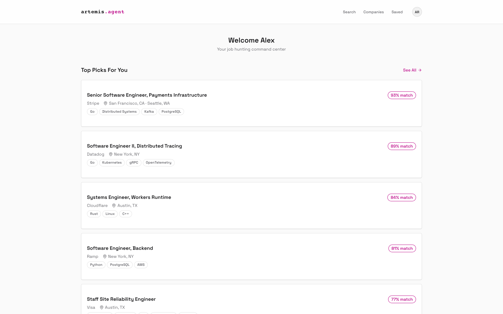
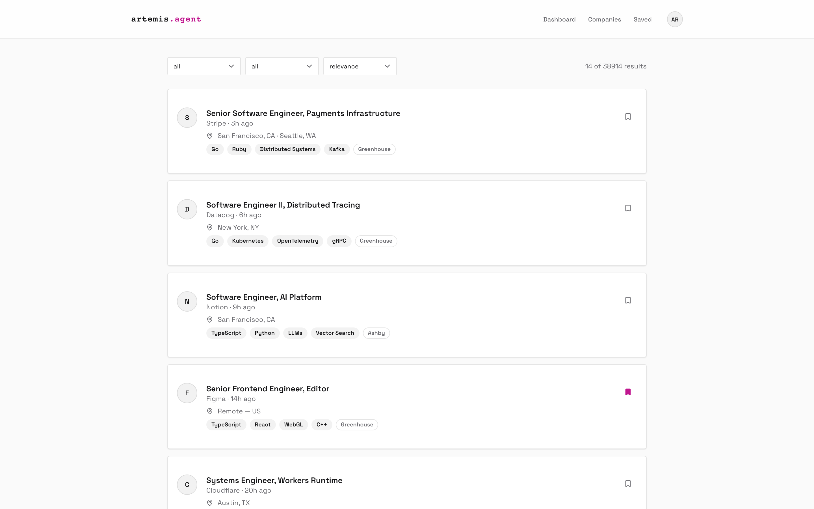
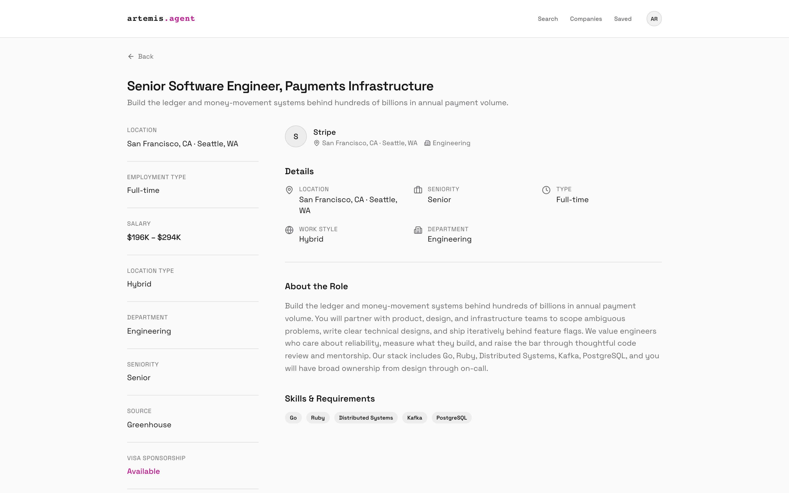
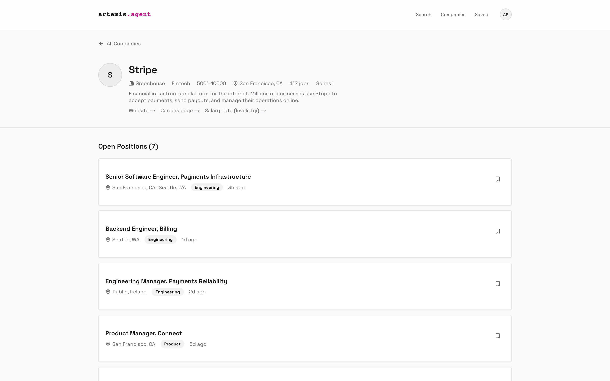

# artemis-web

Web frontend for [Artemis](https://github.com/artemis-agent), a job platform that scrapes openings directly from company applicant tracking systems (ATS) and ranks them against your resume. This repo is the Next.js app users sign in to: job search, company pages, saved jobs, onboarding, and personalized recommendations.



| Job search | Job detail | Company page |
| --- | --- | --- |
|  |  |  |

## What it does

- **Landing page** with a public job search preview (no sign-in).
- **Auth**: sign up, log in, and a forgot-password flow.
- **Onboarding**: a multi-step wizard; upload a resume for AI parsing or fill in the profile by hand.
- **Dashboard**: recommended jobs with match scores.
- **Search**: job feed with filters and sorting.
- **Companies**: browse companies and view each one's ATS, details, and open positions.
- **Saved jobs** and **profile** pages.

Light theme is the default; a dark theme is available via the `.dark` class.

## Where it fits

```text
artemis-web (this repo) --HTTP--> artemis-api (Go) --HTTP--> artemis-worker (Python internal API)
                                        |                         |
                                        +------ PostgreSQL + pgvector ------+
```

The web app talks only to [artemis-api](https://github.com/artemis-agent/artemis-api) through `src/lib/api.ts`. Scraping, enrichment, and recommendations happen in [artemis-worker](https://github.com/artemis-agent/artemis-worker).

## Stack

Next.js 16 (App Router), React 19, TypeScript, Tailwind CSS 4, shadcn/ui on Base UI, Vitest + Testing Library, MSW for API mocking.

## Run locally

```bash
npm install
npm run dev        # http://localhost:3000
```

Environment variables (read at build/dev time):

| Variable | Default | Purpose |
| --- | --- | --- |
| `NEXT_PUBLIC_API_URL` | `http://localhost:8080/api/v1` | Base URL of artemis-api |
| `NEXT_PUBLIC_MOCK_API` | unset | Set to `true` to serve API responses from MSW mock handlers (`src/mocks/`), so the UI runs without the backend |

To run the UI with no backend:

```bash
NEXT_PUBLIC_MOCK_API=true npm run dev
```

Other scripts:

```bash
npm run build      # production build
npm run start      # serve the production build
npm run lint       # ESLint
npm test           # Vitest (single run)
npm run test:watch # Vitest (watch mode)
```

## Project layout

```text
src/
  app/          routes: /, /login, /signup, /forgot-password, /onboarding, /dashboard/*
  components/   job card, search bar, tag input, user nav, ui/ (shadcn primitives)
  lib/          API client, auth context, static lists, utilities
  mocks/        MSW handlers and data factories
  __tests__/    Vitest tests
```

## Related repos

| Repo | Role |
| --- | --- |
| [artemis-web](https://github.com/artemis-agent/artemis-web) | Next.js frontend (this repo) |
| [artemis-api](https://github.com/artemis-agent/artemis-api) | Go HTTP API: auth, search, companies, saved jobs, resume upload |
| [artemis-worker](https://github.com/artemis-agent/artemis-worker) | Python engine: company discovery, ATS detection, scraping, enrichment, recommendations |
